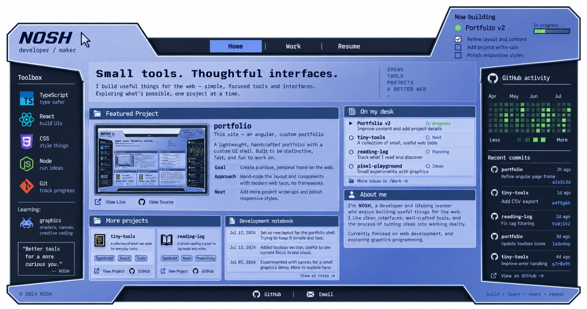
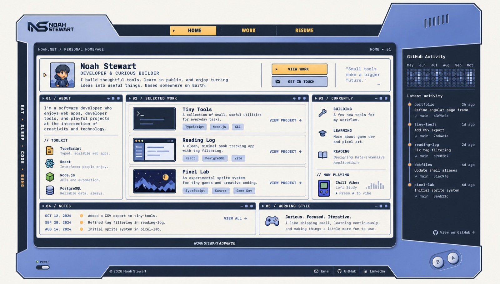
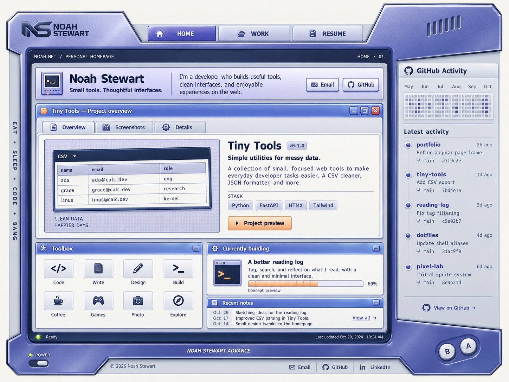
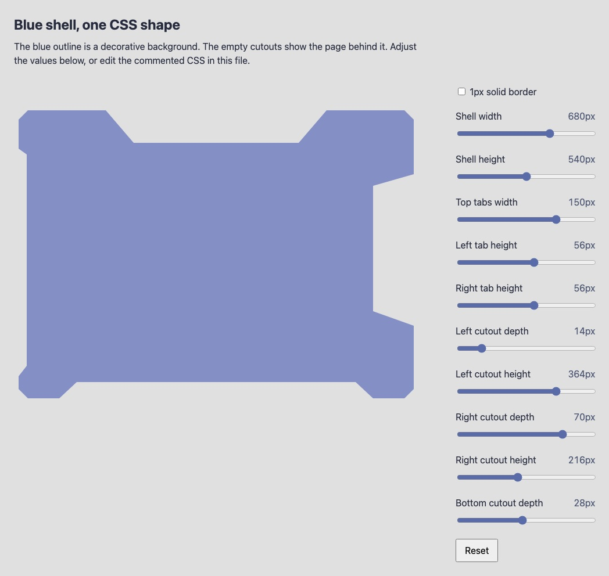
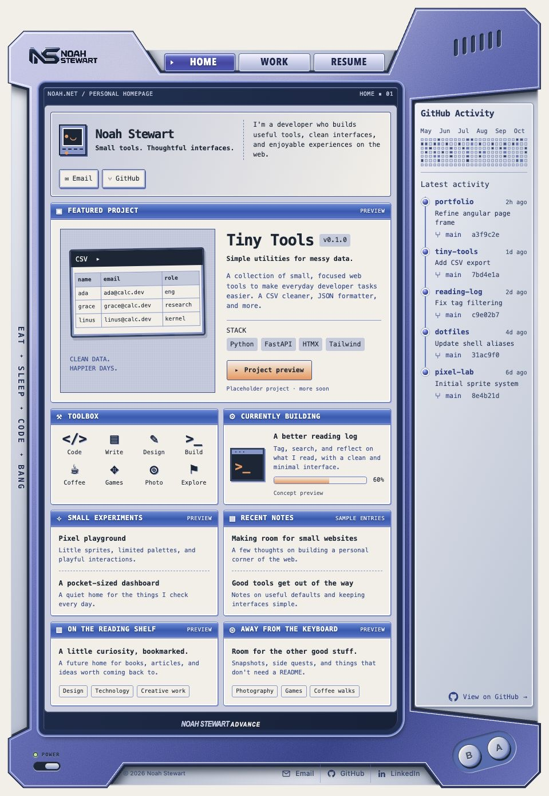
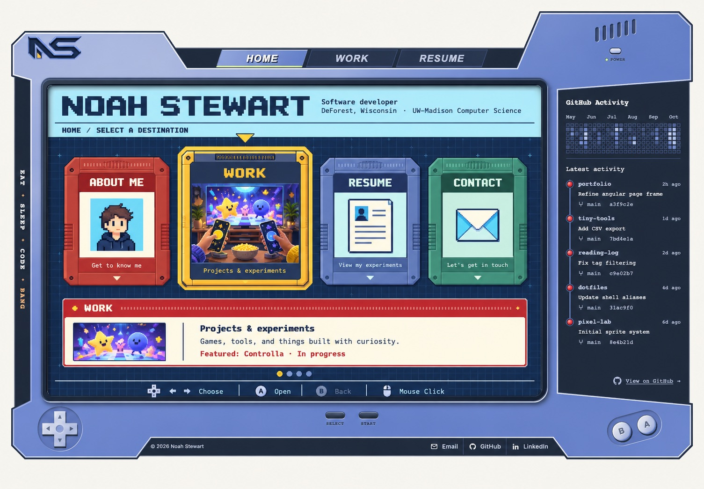
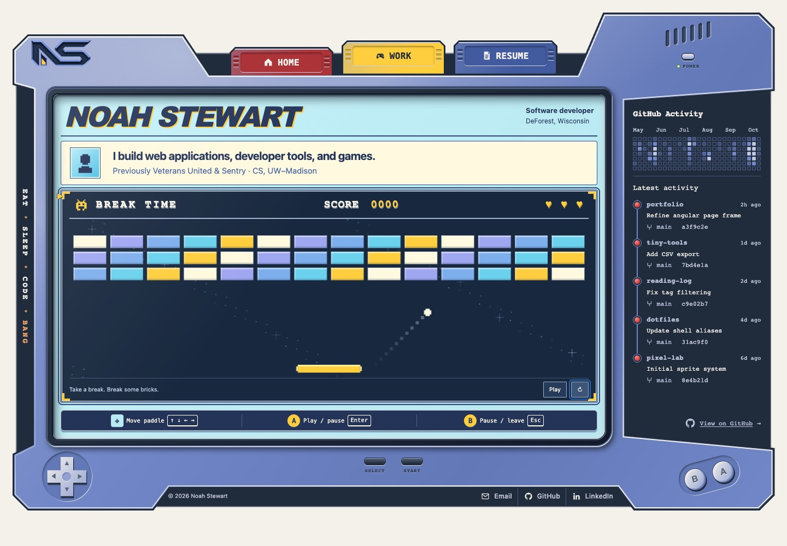
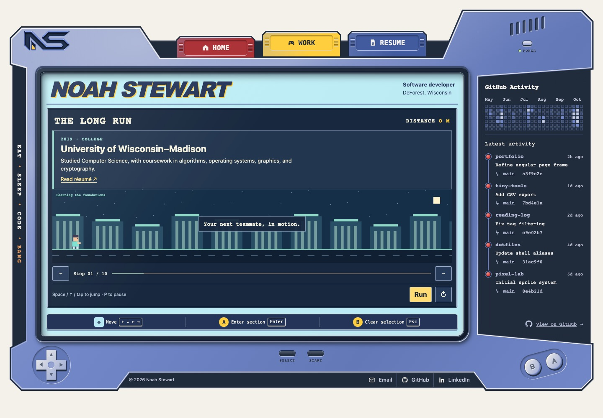
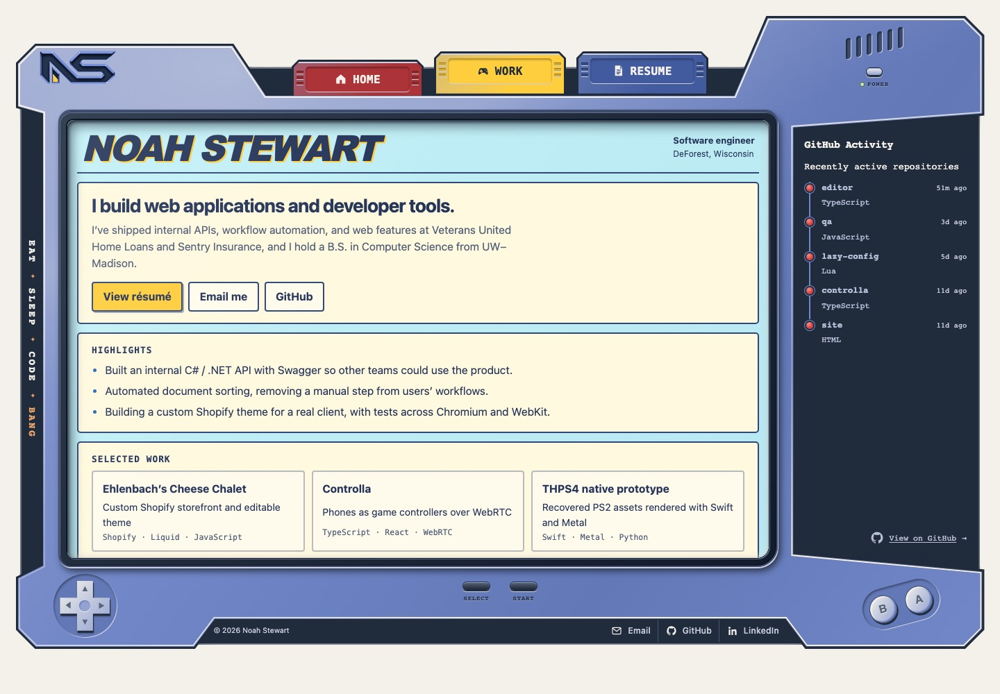
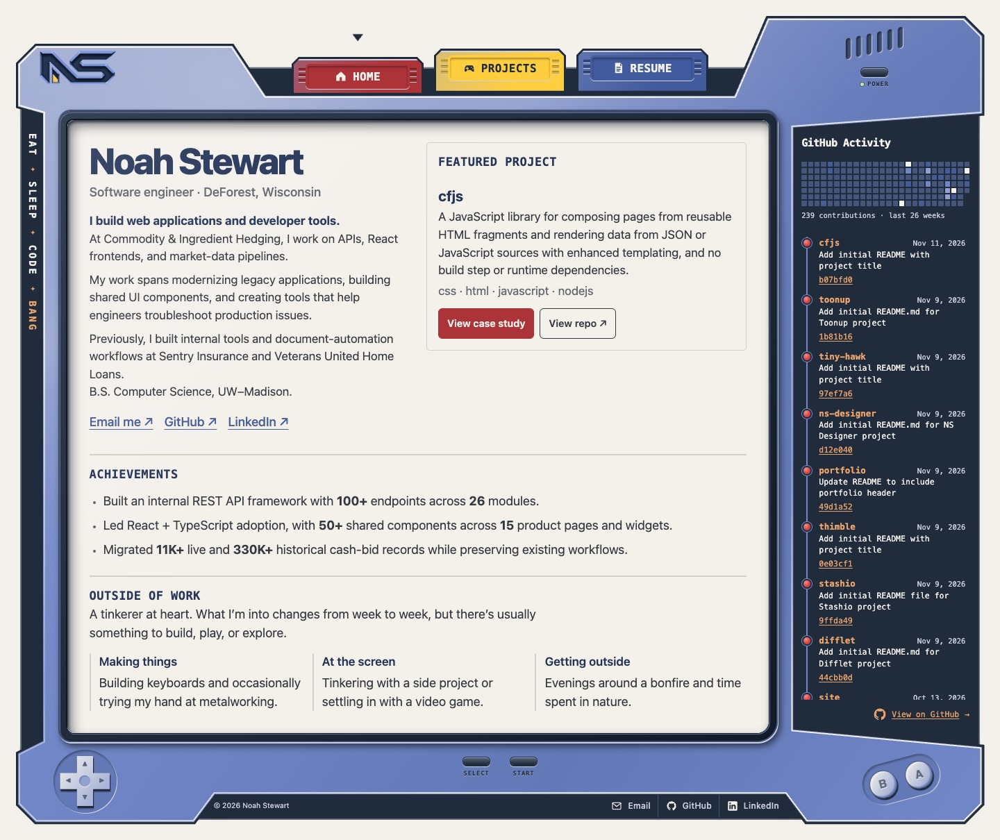

## The short version

This is my portfolio, and the site you're probably reading this on. I wanted a home base I actually love: one place to see my most complete projects, styled like a handheld console I'd have been obsessed with as a kid. Most of the content that changes often, like projects, case studies, and recent activity, loads straight from my GitHub. When I push a project, it shows up here without me touching the site. It's built with [CFJS](https://github.com/noshpotosh/cfjs), the tiny HTML composition library I've been developing alongside it.

## Why I built it

I didn't want a portfolio I'd build once and forget. I wanted a site I'd be excited to put projects on, one that feels like *mine* and not a template with my name swapped in.

Pulling content from GitHub turned out to be the best decision I made. Each project's description, icon, and this exact case study live in that project's own repo. The site just goes and gets them. Honestly, that's become a motivator in its own right. Knowing a finished project will show up here on its own makes me want to keep shipping.

## Iterating with AI

The funny part: even with AI, this "simple" site took me about as long as it would have without it. The difference is what came out the other end.

I'll be upfront. If I'd hand-written every line, or hand-refactored the whole thing, the *code* would be cleaner. I believe that. But that comparison misses what AI actually changed, which is how much I could try before committing to anything:

- **20+ mockups before a single line of HTML or CSS.** I generated whole-page concepts in minutes and used them to figure out what I actually wanted.
- **A one-off design tool, just for the shell.** Before building the real site, I had AI make a small standalone page with controls for adjusting the shape of the console "shell." I tweaked sliders until the silhouette felt right, and only then moved on to the content. By hand, that tool would've taken days. It's so specific and throwaway that I never would have built it. I'd have just nudged numbers in the CSS until it looked okay.
- **Room for weird ideas.** A playable brick-breaker on the home page? A cartridge carousel for navigation? I built them, looked at them, and threw them out. Cheap experiments make it easy to say no.

Those things are force multipliers. Pre-AI, I don't think I'd have landed on something I like this much, at least from a product perspective.

## How it evolved

A few of the early AI mockups, exploring the console-shell idea and what goes inside it:

The standalone page I used to dial in the shell's shape, next to the first coded version of the shell (still full of placeholder content):

Ideas that didn't make the cut, a cartridge carousel for navigation and a playable brick-breaker on the home page:

A late overhaul that cut the noise and put the content first (before → after):

Where it landed:

## What's next

- **Clean up the CSS.** I'm working through the Complete CSS course, and it's full of ideas I want to bring back into this site.
- **Rethink how the shell is built.** It's one of the only parts of the site that uses explicit breakpoints instead of a fluid layout, and I'd like to fix that.
- **Keep pushing CFJS.** Use it better here, and find more ways to extend the framework so it's more helpful.
- **Performance.** Keep improving loading speed and image sizes.
- **Accessibility.** Run manual screen reader passes and improve things across the board.
- **Easter eggs.** The shell's buttons are just sitting there. They deserve to do something fun.
